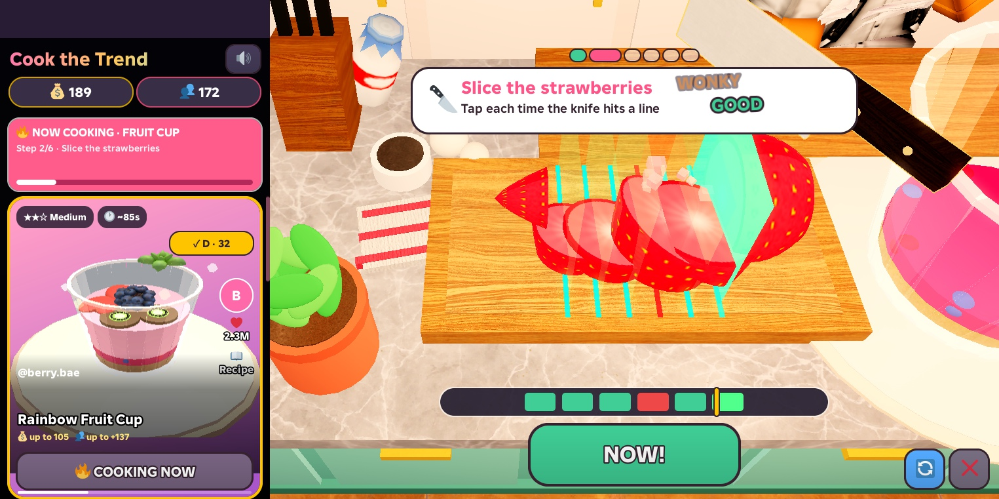

# Cook the Trend

**"I saw this food trend. Can I actually make it?"**

A Roblox cooking game that teaches real recipes. A short-video-style recipe feed sits on the left and a hands-on 3D kitchen on the right. Every step shows the real technique first (a ghost 3D demo plus a one-line tip), then you do it yourself, then you get feedback you can use in a real kitchen. You finish with a recipe card you can take to your own kitchen.

## Recipes
| Recipe | Skills |
|---|---|
| **Rainbow Fruit Cup** (flagship) | pick ingredients, slice strawberries & kiwi, portion yogurt, plate in sections, honey drizzle |
| **Midnight Tonkotsu Ramen** | slice scallions & chashu, boil noodles to the right doneness, pour broth, place toppings |
| **Tower Smash Burger** | slice tomato, sear & flip the patty, stack a centered tower |

## Highlights
- **Learn by doing:** every step runs Demonstrate → Instruct → Do → Feedback.
- **Real recipe card:** ingredients with quantities, numbered steps, 3D "looks like" previews, and your personal recap ("next time…").
- **Real-time mesh slicing:** EditableMesh + EditableImage. Food splits exactly where you cut, with textured cross-sections and realistic slice thickness. Noodle strands relax as they cook.
- **Clear cut cues:** a glowing cut line at each slice, a ▼ marker on the next cut, a NOW! window, and a rhythm bar showing hits and misses.
- **Server-authoritative scoring:** the client sends only raw input timings. The server checks them and re-scores with the shared rules, so a player can't award themselves coins.
- Results show **Yours vs The Video**, a rank, coins and followers, personal bests and a live-chat reaction. All sound effects are licensed Creator Store audio.

## Repo layout
| Path | What |
|---|---|
| `src/shared/` | Config (incl. the `UnlockAll` hackathon toggle), Recipes (gameplay + real-recipe data), StepMath (shared scoring rules), Dish (food models), Coach (feedback text) |
| `src/server/` | sessions, validation, rewards, DataStore persistence |
| `src/client/` | entry script, Feed, Hud, Kitchen (camera, interactions, lessons), Results, RecipeSheet, FruitMesh (EditableMesh), Sfx, Fx, UI |
| `build/` | Luau scripts that build the kitchen set, decor, lighting and asset overrides in Studio |
| `tools/` | `push.ps1` (sync sources into Studio via the Studio MCP), capture helpers |
| `captures/` | screenshots + gameplay GIFs |
| `SPEC.md`, `HANDOFF.md`, `TEST_RESULTS.md`, `REFERENCES.md` | design decisions, how to play, test evidence, references & asset sources |

## Running it
The live build is the Roblox place **Cook The Trend** (placeId `86879072513404`). Open it in Studio and press Play.

To rebuild from this repo into a place:
1. Map `src/` with `tools/manifest.txt` (Studio paths are listed there), or push with `tools/push.ps1`.
2. Run `build/kitchen_build.luau`, `build/decor_build.luau` and `build/lighting_fix.luau` in the Studio command bar.
3. Game Settings → Security: enable **Allow Mesh / Image APIs** (needed for real slicing) and **API Services** (persistence).

Note: the AI-generated food meshes in `ReplicatedStorage.CTTAssets` live in the place itself. The code falls back to built-in procedural models when they're missing.
